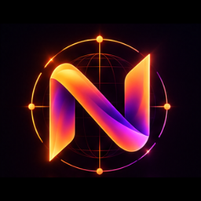
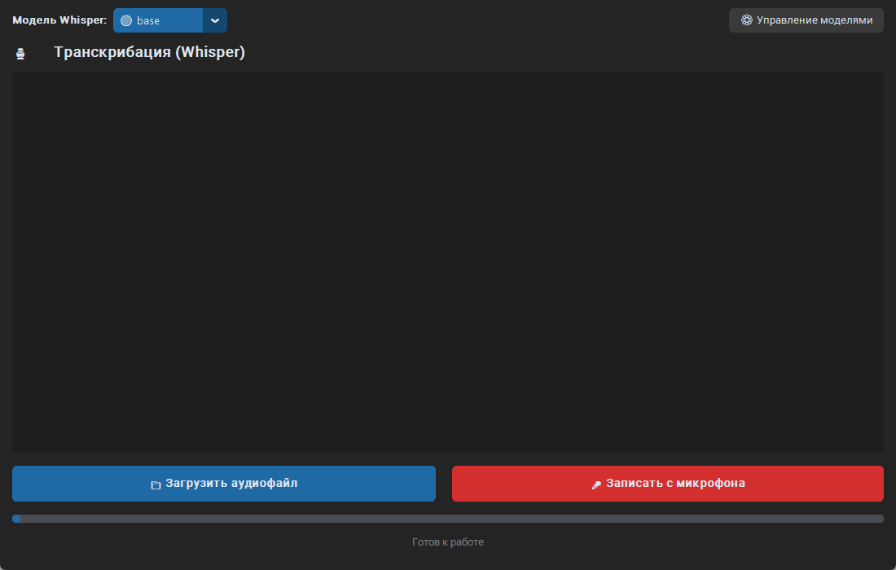

# NordScribe 🎙️



[](https://github.com/frerdok-dotcom/NordScribe/actions/workflows/ci.yml)

**NordScribe** — десктопное приложение для полностью локальной и
конфиденциальной транскрибации аудио в текст через OpenAI Whisper.



## ✨ Возможности

- 🔒 **Полная конфиденциальность**: аудио и текст не уходят в сеть; скачиваются
  только веса моделей с публичного хранилища OpenAI.
- 🎙️ **Whisper**: распознавание речи моделями `tiny` … `large`.
- 🎤 **Запись с микрофона** с потоковой записью на диск: память не зависит от
  длительности, тишина по краям обрезается на лету.
- ⚙️ **Диспетчер моделей**: скачивание и удаление весов, прогресс, SHA-256,
  докачка после обрыва.
- 🟢 **Наглядный выбор модели**: скачанные и отсутствующие модели различаются
  маркером и цветом.
- ⚡ **Отзывчивый интерфейс**: модель грузится лениво, тяжёлые операции — в
  отдельных потоках, Tk обновляется через один диспетчер.
- 📝 **История и настройки**: SQLite-история, выбранная модель и геометрия окна
  сохраняются; журнал — `~/.nordscribe/nordscribe.log`.

## 🛠️ Требования

- Python **3.10+** (для сборки exe рекомендуется 3.12).
- **FFmpeg** — для сжатых форматов (mp3, m4a, ogg, flac):
  - Windows: сборка с [ffmpeg.org](https://ffmpeg.org/download.html), папка `bin` в `PATH`;
  - Linux: `sudo apt install ffmpeg`;
  - macOS: `brew install ffmpeg`.
- **PortAudio** — для записи с микрофона. На Windows колёса `sounddevice`
  содержат его; на Linux нужен `libportaudio2`.
- Микрофон — только для записи; транскрибация файлов работает без него.

## 🚀 Установка

```bash
git clone https://github.com/frerdok-dotcom/NordScribe.git
cd NordScribe

# вариант 1: uv (быстрее)
uv venv .venv
uv pip install -e ".[dev]"

# вариант 2: venv + pip
python -m venv .venv
# Windows
.venv\Scripts\activate
# Linux/macOS
source .venv/bin/activate
python -m pip install -e ".[dev]"
```

`pyproject.toml` — единственный источник зависимостей. Отдельного
`requirements.txt` больше нет.

## ▶️ Запуск

```bash
python -m nordscribe
```

или установленный скрипт:

```bash
nordscribe
```

При разработке без установки пакета:

```powershell
$env:PYTHONPATH = "src"
python -m nordscribe
```

Проверка версии и диагностический прогон:

```bash
python -m nordscribe --version
python -m nordscribe --selftest
python -m nordscribe --selftest --selftest-audio sample.wav
```

`--selftest` проверяет импорты, создание главного окна и окружение; с
`--selftest-audio` дополнительно распознаёт WAV уже скачанной моделью. Коды
возврата: `0` — успех, `1` — ошибка, `2` — нечего распознавать (нет файла или
весов). Результат пишется в `~/.nordscribe/nordscribe.log`.

## 📦 Сборка .exe

```bash
pip install -e ".[build]"
pyinstaller --noconfirm --clean packaging/NordScribe.spec
```

Готовый файл — `dist/NordScribe.exe`. FFmpeg и веса в exe не входят: они
по-прежнему нужны в `PATH` и в `~/.cache/whisper`. Первый запуск занимает
несколько секунд: PyInstaller распаковывает зависимости во временный каталог.

Сборка использует логотип из `src/nordscribe/assets/logo.ico`: он встроен в
exe, поэтому ярлык и панель задач получают правильную иконку.

### Ярлык на рабочем столе

После сборки:

```powershell
powershell -ExecutionPolicy Bypass -File packaging\Create-Shortcut.ps1
```

Скрипт создаёт `NordScribe.lnk` на рабочем столе с иконкой exe. Другой путь:

```powershell
powershell -ExecutionPolicy Bypass -File packaging\Create-Shortcut.ps1 -ShortcutPath .\dist\NordScribe.lnk
```

Сборка проверяется вручную workflow
[`.github/workflows/build-windows.yml`](.github/workflows/build-windows.yml).

## 📁 Структура проекта

```text
src/nordscribe/
├── app.py            # composition root, main()
├── cli.py            # --version, --selftest
├── selftest.py       # диагностический сценарий
├── core/             # каталог моделей, форматирование, ошибки
├── infra/            # пути, настройки, журнал, SQLite, кэш, SHA-256
├── services/         # downloader, model_service, recorder, transcriber, preflight
└── ui/               # theme, dispatcher, widgets, вкладки, окна
tests/                # unit-тесты + архитектурные тесты
docs/                 # ARCHITECTURE, AUDIT, CODEGRAPH, ADR
packaging/            # PyInstaller spec + Create-Shortcut.ps1
```

Слои и зависимости: `core <- infra <- services <- ui`; `app.py` и
`selftest.py` связывают всё. Подробно — [docs/ARCHITECTURE.md](docs/ARCHITECTURE.md).

## ✅ Тесты и качество кода

```bash
pytest
ruff check src tests
ruff format --check src tests
mypy
```

CI (`.github/workflows/ci.yml`) запускает эти же команды на Python 3.12 и
3.13. Тесты не требуют микрофона, весов и интернета: входной поток и загрузчик
модели подменяются, HTTP проверяется на локальном сервере.

Архитектурные тесты (`tests/test_architecture.py`) падают, если:
- слой импортирует запрещённый слой;
- `torch`/`whisper`/`sounddevice`/GUI импортируются на уровне модуля вне UI;
- `import nordscribe.app` тянет тяжёлые зависимости.

## ⚙️ Настройки и данные

| Что | Где |
|---|---|
| Настройки | `~/.nordscribe/settings.json` |
| История | `~/.nordscribe/history.db` (таблица `transcription_history`) |
| Журнал | `~/.nordscribe/nordscribe.log` (ротация 1 МБ, 3 файла) |
| Веса Whisper | `~/.cache/whisper` |

Метки времени SQLite хранит в UTC, показываются в местном времени. Настройки
валидируются по типам и сохраняются атомарно.

## 📖 Как использовать

1. **Скачать модель**: «⚙ Управление моделями» → «Скачать» напротив нужной.
2. **Транскрибация файла**: «📁 Загрузить аудиофайл».
3. **Запись с микрофона**: «🎤 Записать с микрофона», затем «⏹ Остановить
   запись» — распознавание начнётся автоматически.
4. **История**: вкладка «История», карточки с текстом и временем; текст можно
   выделять и копировать.
5. **Очистка истории**: первое нажатие просит подтверждение (5 секунд),
   удаляет второе.

## 🧭 CodeGraph

Проект проиндексирован [CodeGraph](https://github.com/colbymchenry/codegraph).
Для структурных вопросов используйте `codegraph explore "..."` (или MCP-инструмент
`codegraph_explore`), а не grep/read. Настройка, рецепты и troubleshooting —
[docs/CODEGRAPH.md](docs/CODEGRAPH.md); готовый системный промпт —
[docs/codegraph-system-prompt.md](docs/codegraph-system-prompt.md).

```bash
codegraph status .
codegraph sync .
codegraph explore "how does a file reach Whisper?"
```

## 🤝 Вклад

См. [CONTRIBUTING.md](CONTRIBUTING.md). Перед PR:

```bash
ruff check src tests
ruff format --check src tests
mypy
pytest
```

Ветки — от `main`, PR — в `main`, CI должен быть зелёным. История изменений —
[CHANGELOG.md](CHANGELOG.md).

## 📄 Лицензия

MIT License, см. [LICENSE](LICENSE).

---

*Разработано с использованием Python, CustomTkinter и OpenAI Whisper.*
