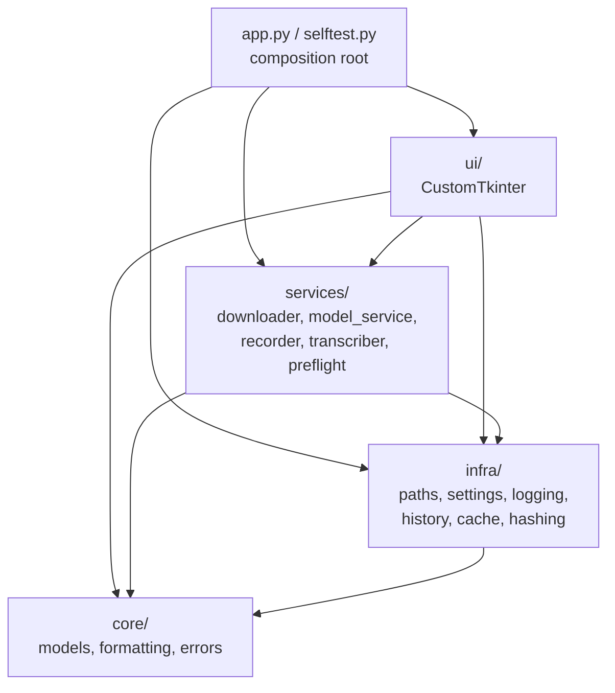

# Архитектура NordScribe

Документ описывает, как устроен проект после рефакторинга 1.1.0: слои,
правила зависимостей, потоки выполнения, хранение данных и точки расширения.
Аудит и список найденных проблем — в [AUDIT.md](AUDIT.md).

## 1. Назначение и границы

NordScribe — настольное приложение для **полностью локальной** транскрибации
аудио через OpenAI Whisper. Приложение:

- не отправляет аудио и текст в сеть;
- скачивает только веса моделей с публичного хранилища OpenAI;
- хранит настройки и историю в домашнем каталоге пользователя;
- работает на Python 3.10+ с CustomTkinter, SQLite и PyInstaller.

Не цели проекта: сервер, многопользовательский режим, облачная синхронизация,
автоматическое обновление.

## 2. Слои и правила зависимостей



Правило: **`core <- infra <- services <- ui`**. `app.py` и `selftest.py` —
единственные модули, которым разрешено импортировать всё. Тест
`tests/test_architecture.py` проверяет это по AST и падает при нарушении.

Дополнительные ограничения:

- `services` не импортирует `nordscribe.ui`;
- `core` не импортирует `infra`, `services`, `ui`;
- `torch`, `whisper`, `sounddevice` и GUI- toolkit не импортируются на уровне
  модуля вне `ui/`; тяжёлые импорты живут внутри функций;
- `import nordscribe.app` не должен загружать torch/Whisper/Tk.

## 3. Карта модулей

| Путь | Слой | Ответственность |
|---|---|---|
| `src/nordscribe/__init__.py` | пакет | версия, краткое описание |
| `src/nordscribe/__main__.py` | вход | `python -m nordscribe`, `freeze_support` |
| `src/nordscribe/app.py` | composition | логирование, настройки, главное окно, `main()` |
| `src/nordscribe/cli.py` | вход | `--version`, `--selftest`, `--selftest-audio` |
| `src/nordscribe/selftest.py` | диагностика | сценарий `--selftest` |
| `core/models.py` | core | каталог моделей, URL/SHA-256, подписи, маркеры |
| `core/formatting.py` | core | `format_bytes` |
| `core/errors.py` | core | иерархия ошибок приложения |
| `infra/paths.py` | infra | `APP_DIR`, `SETTINGS_PATH`, `LOG_PATH`, `WHISPER_CACHE_DIR` |
| `infra/settings.py` | infra | `Settings`, валидация, атомарное сохранение, журнал |
| `infra/history.py` | infra | SQLite-репозиторий истории, `HistoryEntry` |
| `infra/cache.py` | infra | сканирование кэша, проверка SHA-256, удаление |
| `infra/hashing.py` | infra | потоковый SHA-256 |
| `services/downloader.py` | services | HTTP, Range, `.part`, прогресс, checksum |
| `services/model_service.py` | services | каталог + кэш + загрузка + удаление |
| `services/recorder.py` | services | запись с микрофона, потоковая запись, обрезка тишины |
| `services/transcriber.py` | services | владение моделью, очередь, daemon-воркер |
| `services/preflight.py` | services | проверки ffmpeg, кэша, микрофона |
| `ui/main_window.py` | ui | главное окно, состояние, связывание |
| `ui/transcription_tab.py` | ui | поле текста, кнопки, прогресс |
| `ui/history_tab.py` | ui | карточки истории, очистка |
| `ui/model_manager.py` | ui | окно диспетчера моделей |
| `ui/model_menu.py` | ui | покраска пунктов меню |
| `ui/widgets.py` | ui | `CopyButton` |
| `ui/mousewheel.py` | ui | `ScrollController` |
| `ui/dispatcher.py` | ui | очередь worker → Tk |
| `ui/theme.py` | ui | палитра, шрифты, эмодзи-шрифт |

## 4. Потоки выполнения

### 4.1 Запуск

```text
python -m nordscribe
  -> cli.parse_args
  -> setup_logging (~/.nordscribe/nordscribe.log)
  -> Settings.load (~/.nordscribe/settings.json)
  -> app.build_window
       -> ModelService(ModelCache(~/.cache/whisper))
       -> TranscriptionHistory(~/.nordscribe/history.db)
       -> MainWindow
            -> UiDispatcher.start()
            -> AudioRecorder(stream_factory=None)
            -> Transcriber(daemon thread)
            -> build tabs
            -> preflight.run_checks()
            -> history.all(limit=500)
  -> app.mainloop()
```

`import nordscribe.app` не импортирует CustomTkinter: он загружается внутри
`main()` только когда действительно нужен GUI.

### 4.2 Транскрибация файла

```text
кнопка «Загрузить аудиофайл»
  -> askopenfilename (главный поток)
  -> MainWindow._submit_transcription
       -> Transcriber.submit -> queue
       -> daemon worker: ensure_model -> model.transcribe(verbose=None)
       -> on_status/on_done/on_error (worker thread)
       -> UiDispatcher.post
       -> главный поток: обновить TranscriptTab, сохранить в history
```

### 4.3 Запись с микрофона

```text
кнопка «Записать»
  -> AudioRecorder.start
       -> временный WAV (tempfile.mkstemp)
       -> writer thread (daemon)
       -> PortAudio callback: копия блока + peak -> queue
  -> writer thread: trim -> WAV, on_tick раз в секунду
  -> UiDispatcher.post -> статус
  -> stop: stream.stop/close, join writer, вернуть Path
  -> transcriber.submit(temp_path, is_temp=True)
  -> после распознавания/ошибки cleanup_temp_file
```

### 4.4 Загрузка модели

```text
ModelManagerWindow
  -> ModelService.download(name)
       -> download_file(spec.url, cache_dir, expected_sha256=spec.sha256)
       -> Range / .part / прогресс / SHA-256
  -> on_progress/on_status (download thread)
  -> UiDispatcher.post -> прогресс-бар
  -> on_models_changed -> MainWindow.refresh_models
```

### 4.5 Удаление модели

```text
ModelManagerWindow
  -> подтверждение вторым кликом (5 секунд)
  -> ModelService.delete(name)
       -> ModelCache.remove(spec)  # веса + .part
       -> downloaded() -> still_available
  -> сообщение, обновление меню и строк
```

## 5. Потоки и конкурентность

| Поток | Кто создаёт | Что делает | Как завершается |
|---|---|---|---|
| Tk main | `app.mainloop` | все виджеты, `UiDispatcher._drain` | закрытие окна |
| recorder writer | `AudioRecorder.start` | WAV, обрезка тишины, `on_tick` | `stop()` + `join(2s)` |
| transcriber worker | `Transcriber.__init__` | модели и распознавание, по одной задаче | daemon + `shutdown()` |
| download thread | `ModelManagerWindow._start_download` | HTTP и запись `.part` | daemon; отмена флагом |

Правила:

- **Никаких обращений к Tk из рабочих потоков.** `UiDispatcher.post` кладёт
  `(callback, args)` в `SimpleQueue`; главный поток разбирает её в
  `after(33ms)`.
- `AudioRecorder.on_tick` вызывается из writer-потока; в приложении он только
  делает `dispatcher.post`.
- `Transcriber` сериализует задачи одним воркером: две транскрибации
  одновременно бессмысленны и конкурируют за CPU.
- Воркер транскрибации — **daemon**: закрытие окна не ждёт многоминутный
  `model.transcribe`.
- Загрузка модели — отдельный daemon-поток; отмена проверяется между блоками.

## 6. Данные и хранилища

### 6.1 Настройки

`~/.nordscribe/settings.json`:

```json
{
  "model": "base",
  "language": "ru",
  "window_geometry": "1100x700",
  "trim_silence": true
}
```

- неизвестные поля игнорируются;
- значение неверного типа заменяется значением по умолчанию для этого поля;
- запись атомарная: `settings.json.tmp` + `Path.replace`;
- повреждённый JSON не мешает запуску.

### 6.2 История

`~/.nordscribe/history.db`, таблица:

```sql
CREATE TABLE transcription_history (
    id INTEGER PRIMARY KEY AUTOINCREMENT,
    text TEXT NOT NULL,
    created_at TIMESTAMP DEFAULT CURRENT_TIMESTAMP
);
```

- `created_at` — UTC (SQLite `CURRENT_TIMESTAMP`), при показе переводится в
  местное время;
- сортировка — `ORDER BY id DESC`, потому что у метки времени разрешение
  одна секунда;
- отдельный индекс по `id DESC` не нужен: `INTEGER PRIMARY KEY` уже rowid;
- соединение открывается на операцию и всегда закрывается;
- при недоступной базе приложение работает без истории и показывает заглушку.

### 6.3 Кэш весов

`~/.cache/whisper` — путь, который читает `whisper.load_model()`.
`ModelCache`:

- `downloaded()` сканирует `*.pt` и разворачивает алиасы
  (`large-v3.pt` → `large-v3`, `large`);
- `is_valid(spec)` считает SHA-256 и сравнивает с `ModelSpec.sha256`;
- `remove(spec)` удаляет веса и `.part`, возвращая имена и размеры.

### 6.4 Каталог моделей

`core/models.py` — статическая таблица `ModelSpec(name, filename, url, sha256,
size_label)`. URL устроен как у Whisper: `<sha256>/<filename>.pt`. Это убирает
зависимость от приватного `whisper._MODELS` и позволяет импортировать каталог
без torch.

## 7. Ошибки и деградация

| Ситуация | Поведение |
|---|---|
| нет ffmpeg | жёлтый статус, WAV работает |
| нет микрофона | жёлтый статус, запись недоступна |
| кэш моделей недоступен | красный статус (fatal), загрузка невозможна |
| модель повреждена | удаляется, скачивается заново при следующем использовании |
| нет сети | сообщение, `.part` сохраняется для докачки |
| checksum не совпал | `.part` удаляется, понятное сообщение |
| пользователь отменил загрузку | `.part` удаляется, окно закрывается |
| история недоступна | вкладка с заглушкой, транскрибация работает |
| закрытие во время распознавания | воркер-daemon, приложение не висит |
| битый `settings.json` | значения по умолчанию |

Исключения слоя данных и сети заворачиваются в `NordScribeError`-подклассы;
UI показывает короткий текст, журнал хранит traceback.

## 8. UI

- `MainWindow` — единственное место, где создаются recorder, transcriber и
  model manager. Он же хранит `_download_active` / `_transcription_active` и
  блокирует кнопки.
- `TranscriptionTab` и `HistoryTab` не содержат бизнес-логики: только
  виджеты и колбэки.
- `CopyButton` — один виджет для обоих мест; таймер 1.5 с, отмена предыдущего.
- `ScrollController` — один глобальный обработчик колеса, который проверяет
  принадлежность события списку по дереву виджетов. Он снимает глобальные
  привязки CustomTkinter и ставит свои; это осознанный компромисс, потому что
  штатная механика CTkScrollableFrame конфликтует с несколькими зонами.
- `ModelManagerWindow` не хранит состояние моделей: источник истины —
  `ModelService`.

## 9. Сборка и поставка

```text
pyinstaller --noconfirm --clean packaging/NordScribe.spec
```

- вход — `src/nordscribe/__main__.py`;
- `pathex` — `src`;
- `customtkinter`: metadata + data files;
- `whisper`: `collect_all`;
- `scipy.special`, `scipy.linalg` в hidden imports;
- `console=False`;
- FFmpeg и веса не входят в exe.

CI: `.github/workflows/ci.yml` (линтер, формат, типы, тесты на 3.12/3.13).
Ручная сборка Windows: `.github/workflows/build-windows.yml`.

## 10. Точки расширения

### Добавить модель

1. `core/models.py`: `ModelSpec` + `CACHE_ALIASES`.
2. `tests/test_models.py`, `tests/test_cache.py`.
3. При необходимости — `size_label`.
4. `codegraph sync .`.

### Добавить вкладку

1. Новый класс в `ui/`, принимает parent и колбэки.
2. Создать в `MainWindow._build_tabbed_area`.
3. Если нужны фоновые операции — сервис + `UiDispatcher.post`.
4. Тест чистых helper-ов; UI — вручную/`--selftest`.

### Добавить настройку

1. Поле в `Settings` с дефолтом.
2. UI, который её читает/пишет.
3. Тест валидации в `tests/test_settings.py`.
4. `CHANGELOG.md`.

### Добавить формат аудио

Whisper/ffmpeg уже поддерживают большинство форматов; расширьте фильтр в
`MainWindow.start_transcription_thread` и проверку ffmpeg.

## 11. ADR

- [0001 — пакетная архитектура](adr/0001-package-layout.md)
- [0002 — ленивые импорты и daemon-воркер](adr/0002-lazy-imports-and-worker.md)
- [0003 — UI-диспетчер](adr/0003-ui-dispatcher.md)
- [0004 — CodeGraph как структурный индекс](adr/0004-codegraph.md)

## 12. Аудит

Полный отчёт: [AUDIT.md](AUDIT.md). Кратко: устранены плоская раскладка,
неполный `py-modules`, мёртвый код, гонки закрытия, дублирование clipboard и
удаления моделей, тяжёлые импорты на старте, отсутствие валидации настроек и
ACL-мусор в тестах.
